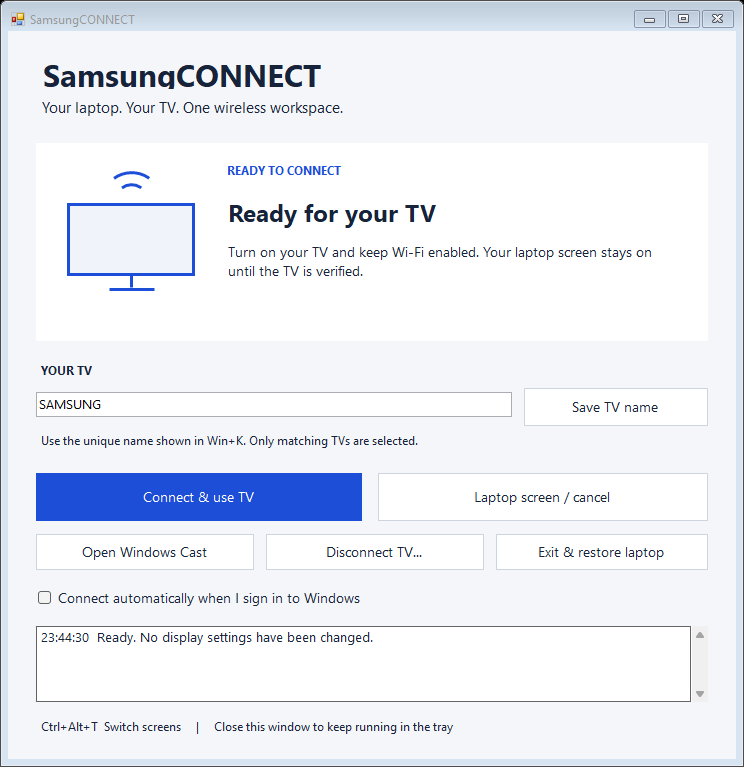

# SamsungCONNECT

A portable Windows 11 utility that connects your laptop to a compatible Samsung TV wirelessly, then makes the TV your only active screen. No HDMI cable, installer, account, or additional app packages are required.

**[Download SamsungCONNECT.exe](https://github.com/nikhilgs817/samsung_connect/raw/refs/heads/main/SamsungCONNECT.exe)** · [Security review](docs/SECURITY-REVIEW.md) · [Build from source](docs/BUILDING.md)

Version 2.0 adds a control window and addresses security and reliability issues found in the original Kimi-generated implementation. The original source is retained in [review/original](review/original/SamsungCONNECT.cs) for comparison; the executable at the repository root is the updated version.



*Control-window preview rendered from the real WinForms UI without connecting a TV.*

## What the app does

- Opens Windows Cast, the same wireless-display interface as **Win+K**.
- Attempts to select a uniquely matching TV using Windows UI Automation. It does not select unrelated devices when no name matches.
- Verifies a named, active Miracast display through Windows' display configuration API before requesting TV-only mode.
- Requests a display layout containing only that TV, disabling the laptop's internal display in Windows. This is not a dimming feature; hardware and driver behavior determines the panel's actual power state.
- Checks whether a TV-like audio device is available. **It does not change or verify the default audio output.** You may need to select TV speakers in Windows once.
- Gives you **15 seconds to keep TV mode**. If you do not confirm, it attempts to restore the laptop screen.
- Monitors the selected display every 2.5 seconds. Two consecutive missing, changed, or unreadable states trigger a laptop-screen restore attempt.
- Keeps controls available in the system tray, with an optional Windows sign-in startup setting.

The app uses Windows' built-in Miracast engine; it does not implement a casting protocol or connect through a cloud service. Windows may briefly mirror or extend the desktop while establishing a cast session before the app requests TV-only mode.

## Requirements

- Windows 11 on a laptop with a built-in display and Miracast-capable Wi-Fi/graphics hardware and drivers.
- A Samsung TV that supports **Miracast / Screen Mirroring** and accepts connections from the laptop. Tizen alone does not guarantee compatibility.
- Wi-Fi enabled on the laptop and the TV ready to receive a wireless-display connection. For the intended home setup, start with both devices on the same home network; Miracast itself uses Wi-Fi Direct.
- The Windows .NET Framework 4.x runtime and Windows UI Automation assemblies. The app has no NuGet dependencies.
- A local interactive desktop session. Remote Desktop sessions and headless machines are not supported targets.

First verify that **Win+K** can connect to the TV manually. SamsungCONNECT cannot add Miracast support to incompatible hardware. Microsoft documents the manual procedure in [Cast to an external display](https://support.microsoft.com/en-us/windows/hardware/display-graphics/screen-mirroring-and-projecting-to-your-pc-or-wireless-display).

## Install

1. Use the **Download SamsungCONNECT.exe** link above. Alternatively, open `SamsungCONNECT.exe` in this repository and choose **Download raw file**, or download the repository ZIP and extract it first.
2. Put the executable in a permanent folder you own, such as `Documents\SamsungCONNECT`. Only this one executable is needed to run the app; the source, build files, and guide are optional.
3. Optionally verify the file against [SHA256SUMS.txt](SHA256SUMS.txt):

   ```powershell
   Get-FileHash -Algorithm SHA256 "$env:USERPROFILE\Documents\SamsungCONNECT\SamsungCONNECT.exe"
   ```

4. Double-click the executable. It opens the control window and **automatically starts a connection attempt**.

The binary is unsigned, so Windows may show a publisher/reputation warning. Verify its origin and checksum before deciding whether to run it. Do not disable antivirus protection or run the app as administrator. Its embedded manifest requests ordinary user privileges.

**Important:** Review the [security findings and testing limits](docs/SECURITY-REVIEW.md) before relying on automatic switching. TV pairing, live topology changes, and connection-loss recovery have not been tested against a physical Samsung TV during this build.

## First-time TV setup

1. Turn on the TV. If necessary, open its **Screen Mirroring**, **Screen Sharing**, or wireless-cast source. Exact menus depend on the model.
2. Press **Win+K** on the laptop and note the TV's displayed name. Confirm that the TV you select is yours.
3. If SamsungCONNECT has already started searching, use **Laptop screen / cancel** to stop its attempt before changing settings.
4. In **Your TV**, enter the full unique TV name, or a unique part of it, and click **Save TV name**. The default is `SAMSUNG`; matching ignores capitalization. Saving the name does not itself connect.
5. Click **Connect & use TV**. If automatic selection is unavailable, select the correct TV manually in Win+K while the app waits.
6. Approve the TV's pairing/sharing prompt. Use an “always allow” option only if you trust the laptop.
7. Wait for the app to verify the display. When the TV becomes the only screen, click **Keep TV mode** within 15 seconds. Otherwise the app restores the laptop.
8. If sound remains on the laptop, open **Windows Settings > System > Sound**, select the TV under output devices, and test playback. Device detection in the app is advisory.

The full attempt can take roughly three minutes: up to 60 seconds of discovery, up to 90 additional seconds for manual connection/display confirmation, up to 15 seconds for audio detection, and the final screen confirmation.

## Everyday use

Turn on the TV, then launch SamsungCONNECT. The app attempts the connection immediately. Once the TV-only layout is verified, use the 15-second confirmation to keep it.

You can close the control window with **X** to leave the app running in the tray. Click its monitor icon near the Windows clock to reopen it; the icon is blue in TV mode and gray otherwise. Hidden tray icons may be under the **^** arrow.

- **Connect & use TV:** Runs the full connection and verification sequence. It is disabled during an attempt or while TV mode is active.
- **Laptop screen / cancel:** Cancels the app's attempt and requests the laptop-only layout. It remains available during a connection attempt. Windows may still finish an already-started wireless session; disconnect through Win+K if needed.
- **Open Windows Cast:** Opens Win+K for manual pairing, selection, or troubleshooting.
- **Disconnect TV...:** Restores the laptop first, then opens Windows Cast. Select **Disconnect** beside your intended TV. This final selection is deliberately manual.
- **Exit & restore laptop:** Restores the laptop if the app is switching or using TV mode, then closes the app. If the restore API reports failure, the app remains open and gives recovery instructions.
- **Save TV name:** Saves the match string for future attempts. Return to the laptop before editing it.

The tray's right-click menu also provides connect, laptop/cancel, disconnect, and exit controls.

### Keyboard shortcut

**Ctrl+Alt+T** starts a verified connection attempt when idle. In TV mode or during an attempt, it cancels and requests the laptop screen instead. If another app owns this hotkey, the activity box tells you; use the buttons or tray menu.

If SamsungCONNECT is unavailable, use Windows' own **Win+P > PC screen only** to recover the laptop screen.

### Start with Windows

Select **Connect automatically when I sign in to Windows**. This saves a per-user startup entry that launches the current executable with `--tray` and immediately attempts the connection. The TV-mode confirmation still appears after a successful switch.

Keep the executable in the same location. If you move it, turn this option off and on from the new location to update the saved path. Clear the checkbox to disable automatic startup.

### Optional launch modes

```powershell
.\SamsungCONNECT.exe --no-connect        # Open controls without an automatic connection attempt
.\SamsungCONNECT.exe --tray              # Start in the tray and attempt connection
.\SamsungCONNECT.exe --tray --no-connect # Tray only, without an automatic attempt
```

Only one instance runs per Windows session. Launching it again is a no-op; open the existing tray icon instead. Exit the original Kimi version before starting this one.

## Troubleshooting

### The TV does not appear

Check the TV power, its screen-mirroring source, laptop Wi-Fi, and the TV's pairing prompt. Try connecting with **Win+K** independently of this app. If manual casting fails, resolve that Windows/TV connection first.

### The TV is listed, but automatic selection does nothing

Use **Open Windows Cast** and select it manually. Automation depends on the current Windows shell and its accessible controls. English pane titles (`Cast`, `Connect`, `Cast to`) are recognized; other languages or newer Windows layouts may require manual selection. The app only automates recognized Windows shell processes in protected system locations, and it does not use physical mouse clicks as a fallback.

### “More than one device matches” or the TV is not verified

Save a more specific name. Two matching TVs, including two with identical names, are rejected. The connected display must also expose a matching friendly name and the Miracast connector type through Windows. If your driver reports a generic/different display name or another connector type, the app will refuse automatic screen switching; use **Win+K** and **Win+P** manually.

Display names are not authentication. Check the physical TV and pairing prompt before sharing sensitive information.

### Another external monitor blocks TV mode

Disconnect other external monitors and retry. The app is intended for one laptop panel plus one TV and rejects ambiguous active external-display setups.

### The laptop screen comes back after switching

Click **Keep TV mode** within the 15-second countdown. If Windows cannot verify the TV-only layout, or the connection changes, the app attempts to restore the laptop. Check the activity box and retry after the TV connection stabilizes.

### The picture works, but there is no TV sound

Select the TV in Windows Sound settings and check TV volume/mute. The app only enumerates legacy audio device names; those names may be truncated, and detection does not prove the default output or working playback.

### The screen stays blank or the app stops responding

Try **Ctrl+Alt+T** while the app is running, or **Win+P > PC screen only** independently. The timer, cancellation, and watchdog are best-effort safeguards; they cannot recover from every driver failure, process crash, forced termination, or unavailable laptop panel. Closing the laptop lid may trigger Windows sleep settings; keep it open unless you have configured and tested lid behavior yourself.

## Settings, privacy, and uninstalling

The application source contains no analytics, updater, account login, credential access, download requests, or application-owned network client. Windows manages the wireless display connection. The activity log stays in memory and is not written to a file.

Only these app settings are written, for the current user:

- `HKEY_CURRENT_USER\Software\SamsungCONNECT`, value `TVName`.
- `HKEY_CURRENT_USER\Software\Microsoft\Windows\CurrentVersion\Run`, value `SamsungCONNECT`, when startup is enabled. The executable path is quoted.

Windows may separately remember TV pairing and display/audio preferences.

To uninstall:

1. Clear **Connect automatically when I sign in to Windows**.
2. Use **Disconnect TV...** and disconnect the TV in Windows Cast if desired.
3. Choose **Exit & restore laptop**.
4. Delete `SamsungCONNECT.exe` and any optional repository files.
5. Optionally remove the `TVName` setting. If the EXE was already deleted, the following removes only this app's registry key and startup value:

   ```powershell
   Remove-ItemProperty -LiteralPath 'HKCU:\Software\Microsoft\Windows\CurrentVersion\Run' -Name 'SamsungCONNECT' -ErrorAction SilentlyContinue
   Remove-Item -LiteralPath 'HKCU:\Software\SamsungCONNECT' -ErrorAction SilentlyContinue
   ```

To update, exit the running app, replace the executable with a newer verified build in the same folder, and launch it. There is no automatic updater.

## Source, build, and validation

- [SamsungCONNECT.cs](SamsungCONNECT.cs): Application code in one C# 5 source file.
- [app.manifest](app.manifest): Embedded Windows compatibility, ordinary-user privilege, and DPI settings.
- [build.ps1](build.ps1): Builds with Windows' .NET Framework compiler; no Visual Studio or NuGet restore.
- [tests/SafetyTests.cs](tests/SafetyTests.cs): Safety policy, interop-layout, read-only native API, and UI rendering checks.
- [Build and testing guide](docs/BUILDING.md): Exact steps, output paths, and hardware validation checklist.
- [Security review](docs/SECURITY-REVIEW.md): Findings in the original app, changes made, and remaining risks.
- [SHA256SUMS.txt](SHA256SUMS.txt): Checksums for the distributed executable and source.

The build and automated checks passed on Windows. The original EXE was compared with a local rebuild, and its bytes matched after normalizing only the PE timestamp and .NET module identifier. That comparison establishes correspondence with the reviewed source, not proof that software is risk-free.

Before reporting a bug, include your Windows version, TV model, whether manual Win+K casting works, and the relevant activity message. Avoid including private screen contents or device information you do not want public.

This is an independent utility, not an official Samsung or Microsoft product. The original implementation was built using Kimi; version 2.0 was reviewed and revised with Codex. No third-party licensing terms have been assigned by this repository; the owner can choose a license separately.
