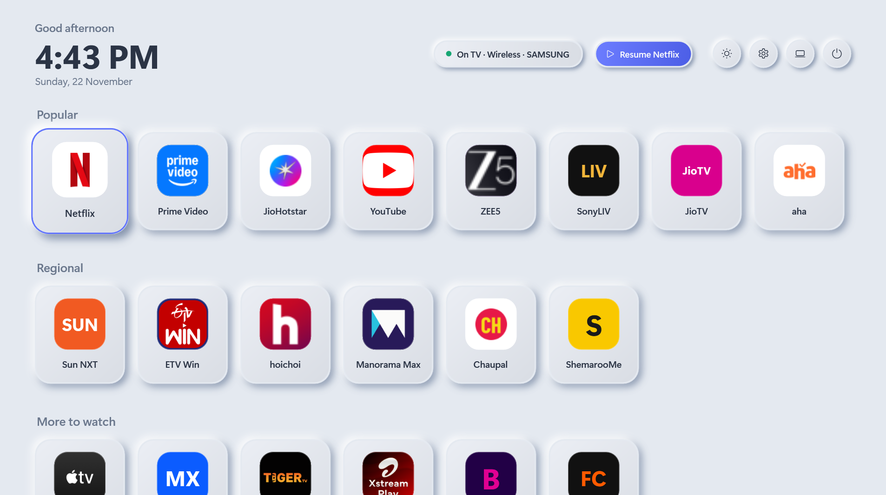
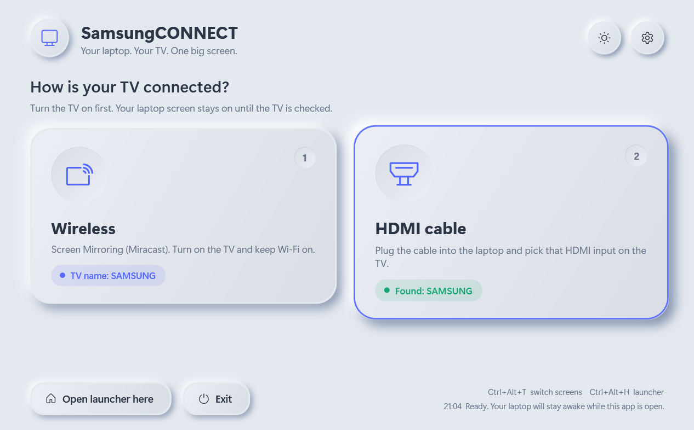
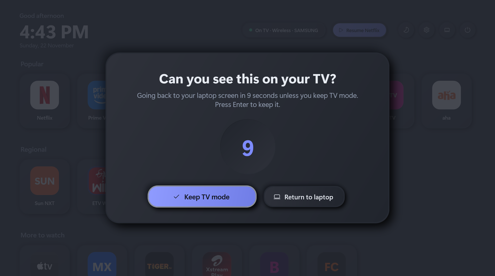
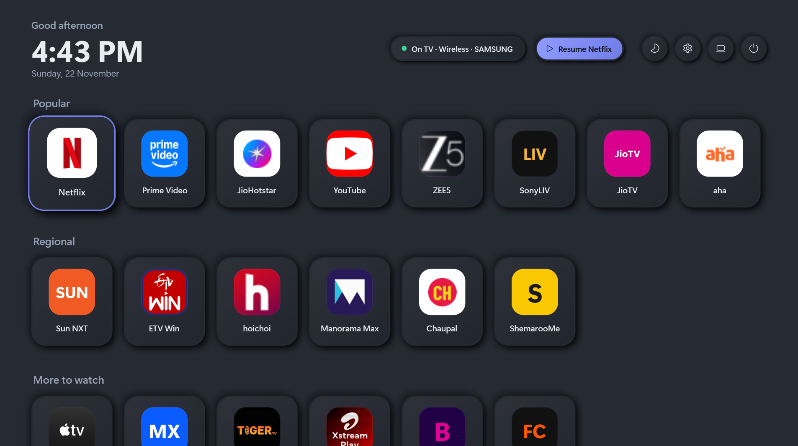
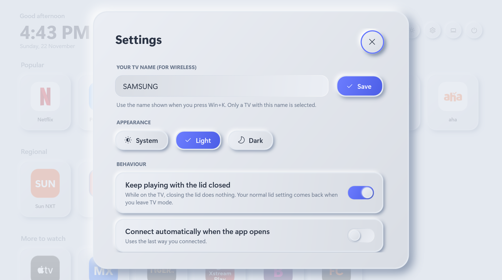

# SamsungCONNECT

Turn your Windows laptop into a smart-TV box. Connect to your TV wirelessly or with an HDMI cable, then pick Netflix, Prime Video, JioHotstar, YouTube and other Indian streaming services from a big-screen home screen. You can drive it all with a wireless mouse and keyboard.

[Download](SamsungCONNECT.exe) · [Build from source](docs/BUILDING.md) · [Security review](docs/SECURITY-REVIEW.md) · [Changelog](CHANGELOG.md)



## How it works

**Step 1 — connect.** Open the app on your laptop and choose how the TV is connected:

| Wireless (Miracast) | HDMI cable |
| --- | --- |
| Finds your TV by name, opens Windows Cast, and selects it for you. Accept the prompt on the TV. | Detects the cable and switches Windows to "second screen only" (the same as Win+P). |



Before anything is final, the TV shows **"Can you see this on your TV?"** with a 15-second countdown. Press **Enter** (or click **Keep TV mode**) to keep it. If you do nothing, the laptop screen comes back on by itself, so a wrong TV or a black screen can't leave you stuck.



**Step 2 — watch.** The laptop screen turns off and the home screen fills the TV:

- Big tiles for **Netflix, Prime Video, JioHotstar, YouTube, ZEE5, SonyLIV, JioTV, aha**, regional services (**Sun NXT, ETV Win, hoichoi, Manorama Max, Chaupal, ShemarooMe**), plus **Apple TV+, Amazon MX Player, Lionsgate Play, Airtel Xstream, Tata Play Binge, FanCode**, and music (**YouTube Music, Spotify, JioSaavn**).
- Click a tile, or move with the **arrow keys** and press **Enter**. The service opens as a full-screen **Chrome** app window that uses your normal Chrome profile, so you stay signed in.
- Close the show with **Alt+F4**, or press **Ctrl+Alt+H** to jump back to the home screen. A **Resume** button takes you back to what you were watching.
- **Add a site** at the end of the list creates your own tile for any web address. Right-click a tile (or press the **Menu** key) to hide or remove it.



## Always awake

While the app is open, your laptop does not sleep, turn off its screen, start the screen saver, or lock. This stops when you exit.

While you're on the TV, **closing the lid does nothing**, so you can shut the laptop and use your wireless keyboard and mouse. Your normal lid setting comes back as soon as you return to the laptop screen or exit. If the laptop crashes or loses power first, the next start puts it back. You can turn this off in Settings.

## Light and dark mode

The soft neumorphic design comes in light and dark. The sun/moon button cycles **System → Light → Dark**. **System** follows your Windows colour mode.

## Keyboard shortcuts

| Keys | What they do |
| --- | --- |
| Arrow keys + Enter | Move between tiles and buttons, open the selected one |
| Ctrl+Alt+H | Bring the home screen to the front (from inside Netflix, YouTube, …) |
| Ctrl+Alt+T | Back to the laptop screen. Press again to reconnect the way you did last time |
| 1 / 2 | On the connect screen: Wireless / HDMI |
| Esc | Close a dialog, or cancel a connection in progress |
| Win+P → PC screen only | Windows' own emergency way back to the laptop screen |

## Settings



- **TV name (for wireless):** the name your TV shows in Win+K, for example `[TV] Samsung 7 Series (43)`. Only a TV whose name contains it is selected. If two TVs match, the app refuses to guess.
- **Appearance:** System, Light or Dark.
- **Keep playing with the lid closed:** on by default.
- **Connect automatically when the app opens:** reuses your last method (wireless or HDMI).
- **Start with Windows.**
- **Refresh logos, Show hidden tiles, Open Windows Cast.**

## Requirements

- Windows 10 or 11 with .NET Framework 4.x (built in).
- **Google Chrome** for the full-screen app windows. Without Chrome the app uses Microsoft Edge, and without either it opens your default browser.
- For wireless: a laptop and TV that support Miracast (Win+K lists the TV). For HDMI: an HDMI port, or USB-C/DisplayPort with an adapter.
- Run it at your desk on a normal Windows sign-in, not over Remote Desktop.

## Install

1. Download [SamsungCONNECT.exe](SamsungCONNECT.exe) and put it in a folder you keep, for example `C:\Apps\SamsungCONNECT`.
2. Optional: check the file against [SHA256SUMS.txt](SHA256SUMS.txt):

   ```powershell
   Get-FileHash .\SamsungCONNECT.exe -Algorithm SHA256
   ```

3. Double-click it. The app isn't code-signed, so Windows SmartScreen may warn you. Choose **More info → Run anyway** only if the checksum matches. It runs with normal user rights and never asks for administrator access.

## First wireless setup (about 3 minutes)

1. Turn on the TV. Press **Win+K** on the laptop once and note the TV's exact name.
2. In SamsungCONNECT, open **Settings**, type the name and click **Save**.
3. Click **Wireless**. When the TV asks for permission, accept it with the TV remote. Choosing "always allow" on the TV makes later connections faster.
4. Press **Enter** on the TV when it asks to keep TV mode.

If sound still plays from the laptop, pick the TV in Windows sound settings once. Windows remembers it.

## Troubleshooting

- **TV not found (wireless):** check the TV name in Settings, make sure Wi-Fi is on and the TV's Screen Mirroring is enabled, then try Win+K by hand.
- **"More than one external display":** HDMI mode only switches when exactly one external screen is connected. Unplug other monitors.
- **Black TV screen:** wait 15 seconds and the laptop screen returns by itself. You can also press Ctrl+Alt+T, or Win+P → PC screen only.
- **TV turned off while watching:** after about 5 seconds the laptop screen comes back. Press Ctrl+Alt+T to reconnect.
- **A logo is missing:** the tile shows a styled brand badge instead. Some sites block automated downloads. Try **Settings → Refresh logos** later.
- **Activity log:** `%LOCALAPPDATA%\SamsungCONNECT\activity.log`

## Privacy and what the app changes

- **Network:** the only network use is downloading each service's icon **from that service's own website** (HTTPS only), on first run, when you add a tile, or when you click Refresh logos. Icons are re-encoded and cached in `%LOCALAPPDATA%\SamsungCONNECT\logos`. Nothing about you is sent, and there is no telemetry and no updater.
- **Streaming:** sites open in your own Chrome. The app never sees your accounts or passwords.
- **Settings** live in `HKCU\Software\SamsungCONNECT`. **Start with Windows** adds a `SamsungCONNECT` value under `HKCU\Software\Microsoft\Windows\CurrentVersion\Run`.
- **Power:** keep-awake is a temporary request that Windows drops when the app closes. The screen saver is paused for this sign-in session only. The lid setting is changed only in TV mode, and the original value is saved first so it can be restored.

To uninstall, turn off **Start with Windows**, exit the app, delete the EXE, and optionally run:

```powershell
Remove-Item -Path 'HKCU:\Software\SamsungCONNECT' -Recurse
```

```powershell
Remove-Item -Path "$env:LOCALAPPDATA\SamsungCONNECT" -Recurse
```

## Source

- `src/` — the app: `Program.cs` (start-up), `Controller.cs` (connect flows, watchdog, tray, hotkeys), `Display.cs` (safety rules and Windows display APIs), `Power.cs` (keep-awake and lid), `Services.cs` (streaming catalog, settings, logo download, Chrome launcher), `Theme.cs` (neumorphic controls), `Ui.cs` (screens).
- `tests/SafetyTests.cs` — 60 automated checks plus screenshots of every screen. These checks never change your display, power or startup settings.
- `build.ps1` — builds with the compiler that ships with Windows. No Visual Studio or NuGet. See [docs/BUILDING.md](docs/BUILDING.md).

Not affiliated with Samsung or any streaming service. Service names and logos belong to their owners; logos are fetched from their own websites and shown only to label the links.
