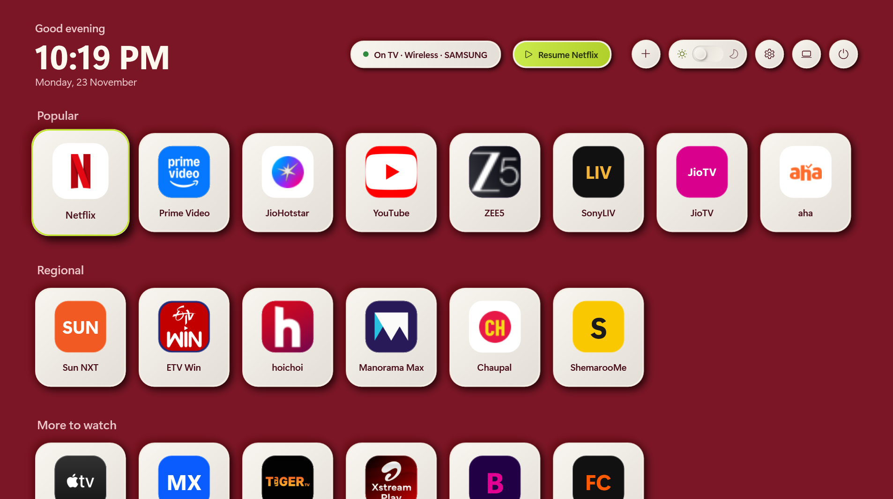
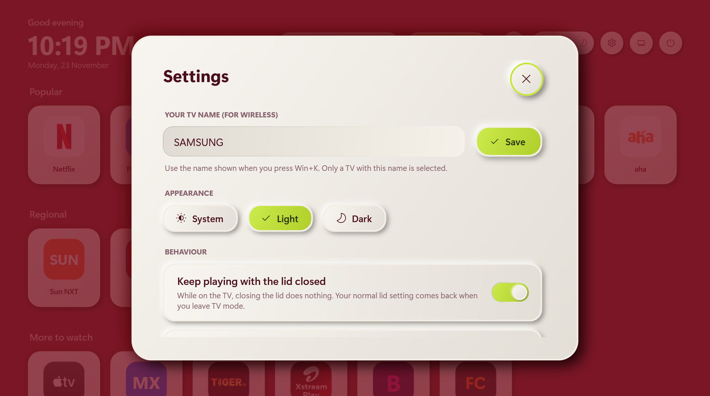
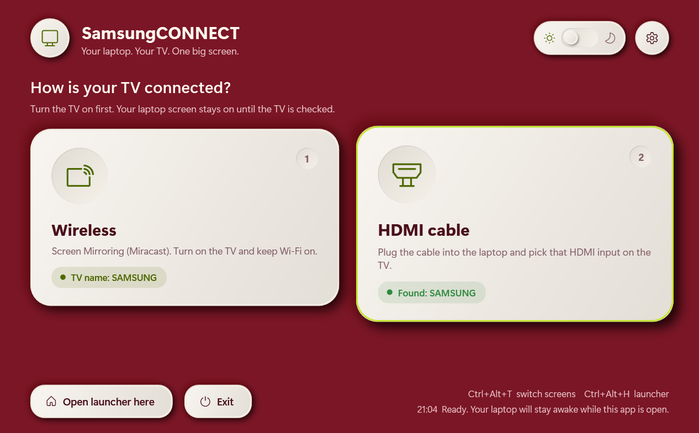
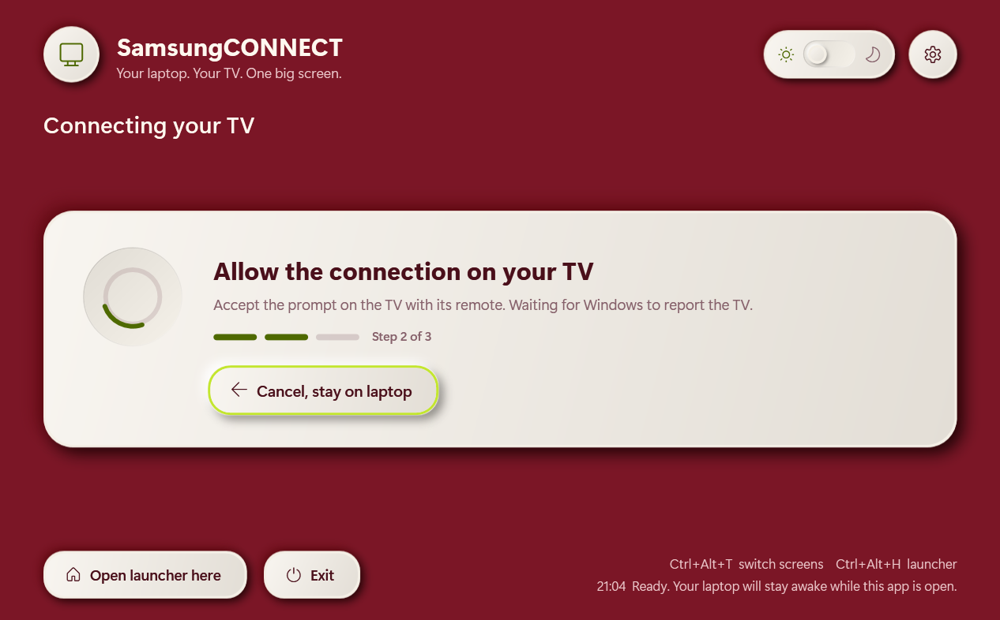
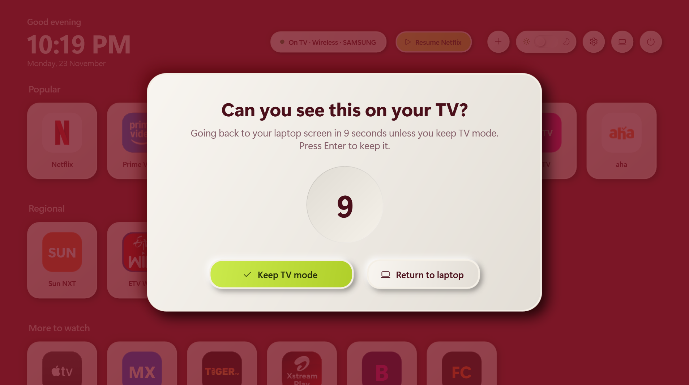
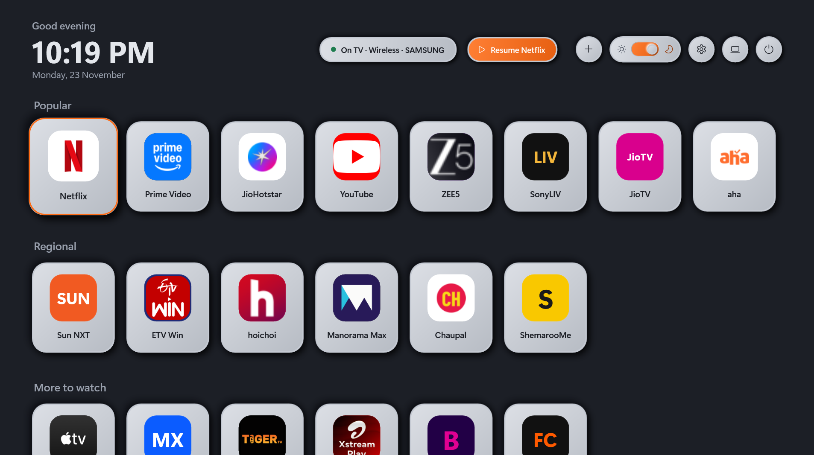
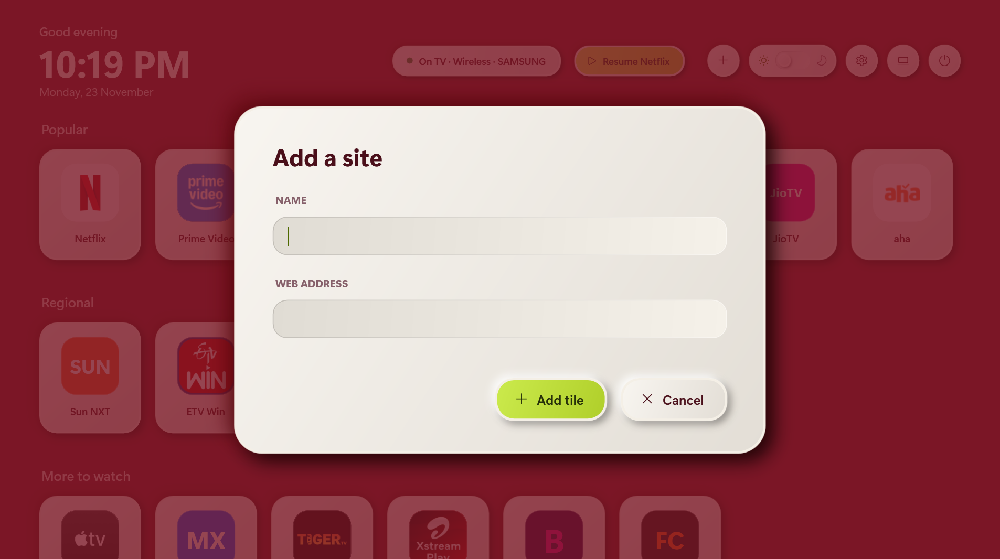
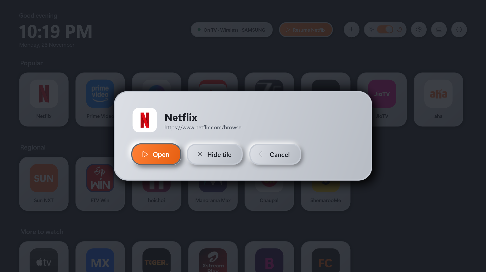
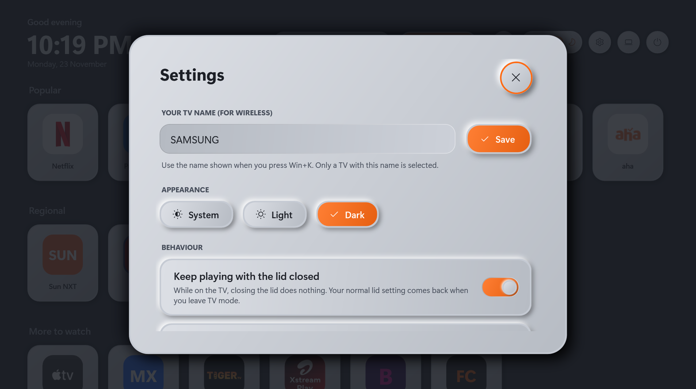
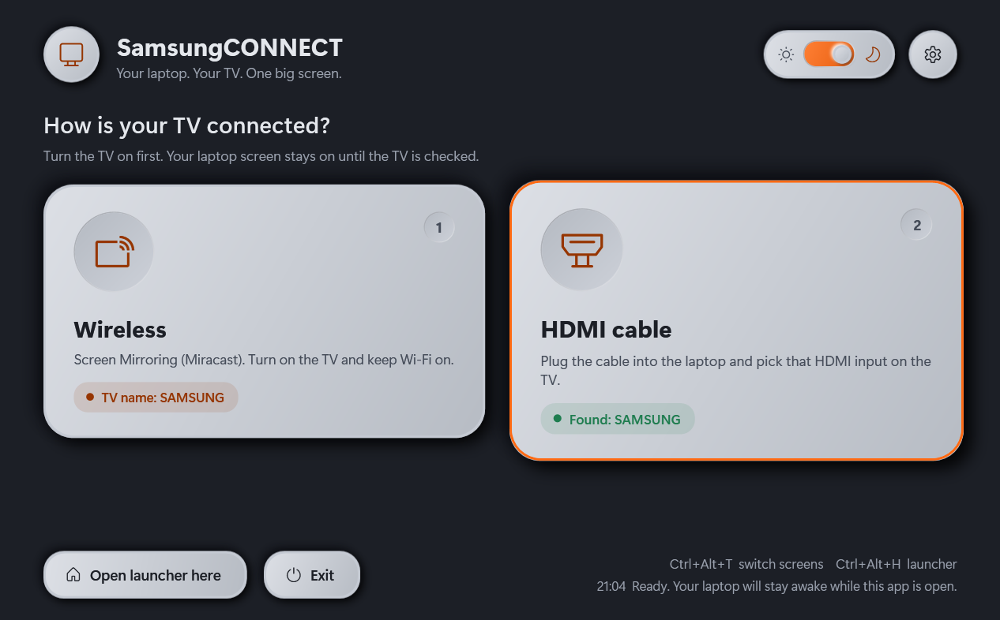

# SamsungCONNECT user guide

Everything you need to set up SamsungCONNECT and use it every day: what it does, installing it, connecting your TV, the home screen, settings, shortcuts and fixing problems.

**Contents**

1. [What SamsungCONNECT is for](#1-what-samsungconnect-is-for)
2. [What you need](#2-what-you-need)
3. [Install](#3-install)
4. [First-time setup](#4-first-time-setup)
5. [Step 1: connect your TV](#5-step-1-connect-your-tv)
6. [Step 2: watch from the TV home screen](#6-step-2-watch-from-the-tv-home-screen)
7. [Add, hide and remove sites](#7-add-hide-and-remove-sites)
8. [Settings](#8-settings)
9. [Light and dark mode](#9-light-and-dark-mode)
10. [Keep-awake and closing the lid](#10-keep-awake-and-closing-the-lid)
11. [Keyboard and mouse controls](#11-keyboard-and-mouse-controls)
12. [Getting back to the laptop screen](#12-getting-back-to-the-laptop-screen)
13. [The tray icon](#13-the-tray-icon)
14. [Troubleshooting](#14-troubleshooting)
15. [Privacy and what the app changes](#15-privacy-and-what-the-app-changes)
16. [Uninstall](#16-uninstall)
17. [FAQ](#17-faq)

---

## 1. What SamsungCONNECT is for

SamsungCONNECT turns a Windows laptop into a smart-TV box. You don't need a streaming stick or a smart-TV app; the laptop does the work, and you sit back with a wireless mouse and keyboard.

It does two things:

1. **Connects the laptop to your TV**, wirelessly (Screen Mirroring / Miracast) or with an **HDMI cable**. It then turns the laptop screen off so the TV is the only screen.
2. **Shows a big-screen home screen** with tiles for Netflix, Prime Video, JioHotstar, YouTube, ZEE5, SonyLIV, JioTV, aha and other popular Indian services. Click a tile and the service opens full screen, already signed in.

While the app is open, the laptop doesn't sleep or lock, and you can close the lid while you watch.



---

## 2. What you need

| | Requirement |
|---|---|
| Computer | Windows 10 or Windows 11 laptop. .NET Framework 4.x is already built into Windows. |
| Browser | **Google Chrome** (recommended). Without Chrome the app uses Microsoft Edge; without either, your default browser. |
| Wireless TV | A Samsung (or other) TV with **Screen Mirroring / Miracast**, and a laptop that supports it. Check: press **Win+K**; if your TV appears in the list, you're set. |
| HDMI TV | An HDMI port on the laptop, or USB-C/DisplayPort with an HDMI adapter, plus an HDMI cable. |
| Controls | A wireless mouse and keyboard (recommended), so you can stay on the sofa. |
| Accounts | Your own subscriptions for each service (Netflix, Prime, and so on). Sign in to them once in Chrome. |

Use the app on a normal Windows sign-in at the laptop, not over Remote Desktop.

---

## 3. Install

There's no installer; it's a single program file.

1. Download **[SamsungCONNECT.exe](../SamsungCONNECT.exe)** from this repository.
2. Move it to a folder you'll keep, for example `C:\Apps\SamsungCONNECT\`. Don't run it from Downloads if you plan to turn on **Start with Windows**.
3. *(Optional)* Check the download wasn't damaged or changed. In PowerShell, in that folder:

   ```powershell
   Get-FileHash .\SamsungCONNECT.exe -Algorithm SHA256
   ```

   Compare the result with the `SamsungCONNECT.exe` line in [SHA256SUMS.txt](../SHA256SUMS.txt).
4. Double-click **SamsungCONNECT.exe**.
   - The app isn't code-signed, so **Windows SmartScreen** may show "Windows protected your PC". Click **More info → Run anyway**, but only if the checksum matched.
   - The app runs with normal user rights and never asks for administrator access.
5. *(Recommended)* Open Chrome once and sign in to the services you use (Netflix, Prime Video, Hotstar and so on). The app opens them in your normal Chrome profile, so they stay signed in.

---

## 4. First-time setup

This takes about 3 minutes and is only needed once.

### For a wireless TV

1. Turn on the TV.
2. On the laptop press **Win+K** and note the TV's exact name, for example `[TV] Samsung 7 Series (43)` or just `SAMSUNG`. Close the panel.
3. In SamsungCONNECT, click the **gear icon** (Settings) at the top right.
4. Type the name (or a unique part of it) under **Your TV name (for wireless)** and click **Save**.

   

5. Close Settings and continue with [Step 1](#5-step-1-connect-your-tv).

> **Why the name matters:** the app only connects to a TV whose name contains what you saved. If two TVs match, it refuses to guess, so a neighbour's TV is never picked by mistake.

### For an HDMI TV

Nothing to set up: plug in the cable and go to [Step 1](#5-step-1-connect-your-tv).

---

## 5. Step 1: connect your TV

Open SamsungCONNECT. The connect screen asks how your TV is connected:



| Card | Press | What happens |
|---|---|---|
| **Wireless** | `1` or click | The app opens Windows Cast, finds your TV by its saved name and selects it. **Accept the prompt on the TV with the TV remote.** Choosing *Always allow* on the TV makes later connections faster. |
| **HDMI cable** | `2` or click | The app checks that exactly one external screen is plugged in. Its name shows on the card as **Found: …**. It then switches Windows to "second screen only". |

Before you start, switch the TV to the right input: **Screen Mirroring** for wireless, or the right **HDMI** input.

### While it connects

A progress card shows the current step. You can cancel at any time with **Cancel, stay on laptop** or **Esc**.



### Confirm on the TV

Once the TV is showing the picture, it asks **"Can you see this on your TV?"** with a 15-second countdown.



- Press **Enter** (or click **Keep TV mode**) to keep it.
- If you **do nothing**, or click **Return to laptop**, the laptop screen comes back automatically. This is a safety net: if the picture went to the wrong screen, or the TV is blank, you're never stuck with a dark laptop.

After you confirm, the laptop screen turns off and the home screen fills the TV.

---

## 6. Step 2: watch from the TV home screen



**Top bar, left to right:**

| Item | What it does |
|---|---|
| Greeting, clock, date | Easy to read from the sofa. |
| **On TV · Wireless · SAMSUNG** | How you're connected, and to which TV. |
| **▶ Resume …** | Brings back the show you opened last. It appears only while that window is still open. |
| **+** | Add your own site ([section 7](#7-add-hide-and-remove-sites)). |
| **☀ ◐ ☾ switch** | Light or dark mode ([section 9](#9-light-and-dark-mode)). |
| **Gear** | Settings ([section 8](#8-settings)). |
| **Laptop icon** | Back to the laptop screen. |
| **Power icon** | Exit the app and restore the laptop screen. |

**Tiles are grouped into rows:**

- **Popular:** Netflix, Prime Video, JioHotstar, YouTube, ZEE5, SonyLIV, JioTV, aha
- **Regional:** Sun NXT, ETV Win, hoichoi, Manorama Max, Chaupal, ShemarooMe
- **More to watch:** Apple TV+, Amazon MX Player, Lionsgate Play, Airtel Xstream, Tata Play Binge, FanCode
- **Music:** YouTube Music, Spotify, JioSaavn
- **My tiles:** sites you added, plus an **Add a site** tile

### Opening a service

1. Point at a tile with the mouse, or move to it with the **arrow keys**. The selected tile grows and gets a coloured ring.
2. Click it, or press **Enter**.
3. The service opens as a **full-screen Chrome window**. You're already signed in if you signed in once in Chrome.

### Coming back to the home screen

- **Alt+F4** closes the show and leaves you on the home screen.
- **Ctrl+Alt+H** brings the home screen to the front and leaves the show open, so you can use **Resume** later.
- Opening a different tile closes the previous show window first, so only one show is open at a time.

### Logos

On first start the app downloads each service's icon from that service's own website and keeps a copy. If a site blocks the download, the tile shows a coloured badge with the service's initials instead, as JioTV and SonyLIV do in the screenshots. You can retry from **Settings → Refresh logos**.

---

## 7. Add, hide and remove sites

### Add a site

Any of these opens the **Add a site** box:

- the **+** button in the top bar
- the **Add a site** tile at the end of the list
- **Settings → Add a site**



1. **Name:** what the tile should say, up to 40 characters, for example `Doordarshan`.
2. **Web address:** for example `waves.pb.gov.in` or `https://www.youtube.com/@channel`. `https://` is added for you. Only normal web addresses are accepted.
3. Click **Add tile**. The tile appears under **My tiles**, and the app tries to fetch that site's logo.

### Hide or remove a tile

**Right-click** any tile, or select it and press the keyboard's **Menu** key:



| Button | For | Result |
|---|---|---|
| **Open** | any tile | Opens it. |
| **Hide tile** | built-in tiles (Netflix, …) | Hides it from the home screen. **Settings → Show hidden tiles** brings all of them back. |
| **Remove tile** | sites you added | Deletes it. |

You can also remove added sites from **Settings → Your sites → Remove**.

---

## 8. Settings

Open with the **gear icon**. Close with the **×**, or **Esc**.



| Setting | Default | What it does |
|---|---|---|
| **Your TV name (for wireless)** | `SAMSUNG` | The name the app looks for in Win+K. Type it and click **Save**. You can only change it while you're on the laptop screen. |
| **Appearance** | System | **System** follows Windows' light/dark setting; **Light** or **Dark** fixes it. |
| **Keep playing with the lid closed** | On | In TV mode, closing the lid does nothing, so the laptop keeps playing. See [section 10](#10-keep-awake-and-closing-the-lid). |
| **Connect automatically when the app opens** | Off | When the app starts, it reconnects the way you did last time (wireless or HDMI). |
| **Start with Windows** | Off | Opens SamsungCONNECT when you sign in. Combine with auto-connect for a one-step TV. |
| **Your sites** | — | Every site you added, each with a **Remove** button. |
| **Add a site** | — | Opens the Add a site box. |
| **Refresh logos** | — | Downloads all logos again. |
| **Show hidden tiles** | — | Brings back built-in tiles you hid. |
| **Open Windows Cast** | — | Opens Win+K, for example to disconnect a wireless TV completely. |

All settings are saved immediately.

---

## 9. Light and dark mode

Flip the **sun ◐ moon switch** at the top of the connect screen or the home screen to change instantly. To follow Windows' own light/dark setting instead, choose **Settings → Appearance → System**.

| | Light | Dark |
|---|---|---|
| Background | Cherry lacquer | Midnight graphite |
| Tiles and cards | Milk porcelain | Lunar silver |
| Highlights | Citrus lime | Signal orange |

| Light | Dark |
|---|---|
|  |  |

---

## 10. Keep-awake and closing the lid

**While the app is open**, the laptop does not:

- go to sleep
- turn its screen off
- start the screen saver
- lock itself

This stops as soon as you exit the app.

**While you're on the TV**, closing the lid does nothing. Shut the laptop, put it aside, and use your wireless keyboard and mouse.

- Your normal lid setting (usually "Sleep") comes back when you return to the laptop screen or exit.
- If the laptop crashes or loses power while in TV mode, the next start of the app puts your lid setting back.
- To keep Windows' normal lid behaviour even on the TV, turn off **Settings → Keep playing with the lid closed**.

> On work laptops with a company "lock after inactivity" policy, the policy still wins.

---

## 11. Keyboard and mouse controls

| Keys | Where | What they do |
|---|---|---|
| **Arrow keys** | everywhere | Move between tiles and buttons, the way a TV remote does. |
| **Enter** / **Space** | everywhere | Open or press the selected item. |
| **Esc** | dialogs / connecting | Close the dialog, or cancel the connection. |
| **1** / **2** | connect screen | Wireless / HDMI. |
| **Menu key** | on a tile | Open, hide or remove it (same as right-click). |
| **Ctrl+Alt+H** | anywhere, even inside Netflix | Bring the home screen to the front. |
| **Ctrl+Alt+T** | anywhere | Go back to the laptop screen. Press again to reconnect the way you did last time. |
| **Alt+F4** | inside a show | Close the show and go back to the home screen. |
| **F11** | inside a show | Toggle full screen. |
| **Win+P → PC screen only** | anywhere | Windows' own emergency route back to the laptop screen. |

**Mouse:** hovering selects a tile, just like the arrow keys, so you can mix mouse and keyboard freely. Right-click a tile for its menu.

---

## 12. Getting back to the laptop screen

Any of these works:

- the **laptop icon** in the home screen's top bar
- **Ctrl+Alt+T**
- the **power icon** (this also exits the app)
- tray icon → **Laptop screen / cancel**
- **Win+P → PC screen only**, if all else fails

The app also brings the laptop screen back by itself when:

- you don't confirm **Keep TV mode** within 15 seconds;
- the TV is switched off, the cable is unplugged, or the wireless connection drops. This takes about 5 seconds.

To reconnect afterwards, press **Ctrl+Alt+T**.

---

## 13. The tray icon

SamsungCONNECT keeps an icon in the taskbar's notification area, next to the clock. It's **blue** in TV mode and **grey** on the laptop screen.

- **Left-click:** open the app.
- **Right-click** gives these options:
  - Open SamsungCONNECT
  - Connect wireless TV
  - Connect HDMI TV
  - Laptop screen / cancel
  - Exit and restore laptop

Closing the window with **×** on the laptop screen keeps the app running in the tray, so keep-awake and the shortcuts keep working. To quit completely, use **Exit**.

Starting SamsungCONNECT again while it's already running just brings the open window to the front.

---

## 14. Troubleshooting

| Problem | What to do |
|---|---|
| **"The TV … was not found"** (wireless) | Check the TV name in Settings matches what Win+K shows. Make sure the TV is on, Screen Mirroring is enabled, and the laptop's Wi-Fi is on. Then try connecting through Win+K yourself once. |
| **The TV asks for permission every time** | When the TV prompt appears, choose **Always allow**. |
| **"More than one external display is connected"** | HDMI mode switches only when exactly one external screen is plugged in. Unplug other monitors. |
| **"A wireless display is connected"** (HDMI) | Disconnect the wireless TV in Win+K first. |
| **HDMI card says "Not detected yet"** | Check the cable, turn the TV on, and pick the right HDMI input on the TV. Some adapters need the TV switched on before the laptop sees it. |
| **TV screen is black** | Wait. The laptop screen returns within 15 seconds, or press **Ctrl+Alt+T**. |
| **The picture dropped while watching** | The laptop screen came back automatically. Press **Ctrl+Alt+T** to reconnect. |
| **Sound plays from the laptop, not the TV** | Click the speaker icon in the taskbar and pick the TV as the output device. Windows remembers it. |
| **A show opens in a window, not full screen** | Press **F11** in the show. |
| **A service asks me to sign in** | Sign in once in that Chrome window; it remembers you after that. |
| **A logo is missing or looks wrong** | **Settings → Refresh logos**. Some sites block downloads; those tiles keep the coloured badge. |
| **Ctrl+Alt+T or Ctrl+Alt+H does nothing** | Another app already uses that shortcut. Use the buttons or the tray icon instead. The activity log says which shortcut failed. |
| **The laptop went to sleep anyway** | Make sure the app is still running (tray icon). A company inactivity policy can override it. |
| **Lid closed and the laptop slept** | Check **Settings → Keep playing with the lid closed** is on. It only applies while you're on the TV. |

**Activity log.** For anything else, check what the app did here:

```text
%LOCALAPPDATA%\SamsungCONNECT\activity.log
```

Paste that path into the File Explorer address bar to open it.

---

## 15. Privacy and what the app changes

- **No account, no tracking, no updater.** The app doesn't collect or send anything about you.
- **Internet use:** only to download each service's logo from that service's own website, over HTTPS. This happens on first start, when you add a site, or when you click Refresh logos. The images are re-saved as plain PNG files in `%LOCALAPPDATA%\SamsungCONNECT\logos`.
- **Your streaming accounts** stay in Chrome. The app never sees passwords.
- **Settings** are stored in the registry at `HKCU\Software\SamsungCONNECT`.
- **Start with Windows** adds one entry at `HKCU\Software\Microsoft\Windows\CurrentVersion\Run`.
- **Power:**
  - The keep-awake request disappears when the app closes.
  - The screen saver is paused for the current sign-in only.
  - The lid setting is changed only in TV mode. The original is saved first, then restored.
- **Permissions:** runs as a normal user, never as administrator.

More detail is in the [security review](SECURITY-REVIEW.md).

---

## 16. Uninstall

1. In **Settings**, turn off **Start with Windows**.
2. Exit the app: power icon, **Exit**, or tray → **Exit and restore laptop**.
3. Delete `SamsungCONNECT.exe`.
4. *(Optional)* Remove saved settings and logos in PowerShell:

   ```powershell
   Remove-Item -Path 'HKCU:\Software\SamsungCONNECT' -Recurse
   ```

   ```powershell
   Remove-Item -Path "$env:LOCALAPPDATA\SamsungCONNECT" -Recurse
   ```

---

## 17. FAQ

**Does it only work with Samsung TVs?**
No. Any TV that supports Miracast (wireless) or has an HDMI port works. "Samsung" is only the default wireless name, so change it in Settings.

**Do I need Chrome?**
It's recommended: shows open full screen with your logins. Without Chrome the app uses Edge, and otherwise your default browser.

**Can I use the home screen without switching screens?**
Yes. Click **Open launcher here** on the connect screen. This is useful if you've already set up the TV yourself with Win+P.

**Does the laptop screen really turn off?**
Yes. In TV mode, Windows uses only the TV. Use any of the ways in [section 12](#12-getting-back-to-the-laptop-screen) to bring the laptop screen back.

**Can I add a live-TV channel or a YouTube channel?**
Yes. Add its web address as a site ([section 7](#7-add-hide-and-remove-sites)).

**Will it change my settings permanently?**
No. The lid setting is put back when you leave TV mode, and keep-awake ends when the app closes. Everything else stays under `SamsungCONNECT` in your user settings.

---

*Building from source or testing:* see [BUILDING.md](BUILDING.md). *Version history:* [CHANGELOG.md](../CHANGELOG.md).
